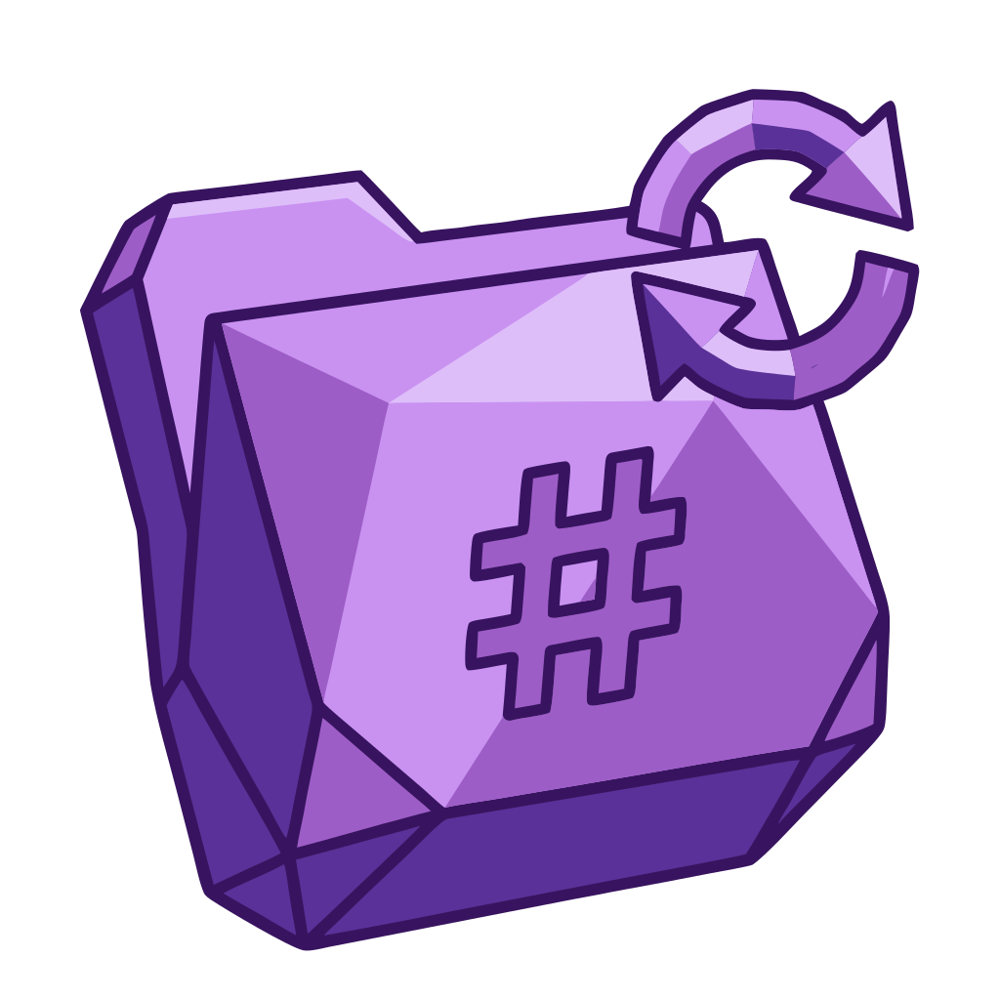

<p align="center">
  
</p>

<h1 align="center">Folder Tag Sync</h1>

<p align="center">
  <strong>Build, manage, and maintain the structure of your Obsidian knowledge workspace.</strong><br>
  Folders and tags kept in agreement by rules you can read, preview, and trust.
</p>

<p align="center">
  <a href="https://github.com/cybersader/obsidian-folder-tag-sync/releases/latest"></a>
  <a href="https://github.com/cybersader/obsidian-folder-tag-sync/blob/main/LICENSE"></a>
  <a href="https://cybersader.github.io/obsidian-folder-tag-sync"></a>
</p>

<p align="center">
  <a href="#how-it-works">How it works</a> •
  <a href="#install">Install</a> •
  <a href="#first-ten-minutes">First ten minutes</a> •
  <a href="https://cybersader.github.io/obsidian-folder-tag-sync">Docs</a> •
  <a href="#status">Status</a>
</p>

---

## Why

A knowledge workspace needs two kinds of structure at once:

- **Folders** give every note one home. They suit storage, ownership, and sharing.
- **Tags** let a note belong to many ideas at once. They suit thinking and finding.

Keeping the two in step by hand drifts quickly. Folder Tag Sync turns your organizing scheme into explicit rules. A rule maps a folder like `Projects/Garden redesign` to a tag like `#projects/garden_redesign`, and maps the tag back to the folder. The rules are deterministic and previewable, and nothing is ever guessed by AI.

## How it works

The plugin follows the life of a workspace's structure:

| Stage | What you do | What the plugin gives you |
|---|---|---|
| **Build** | Point it at your vault | The **Taxonomy Workbench** detects the organizational systems you already use, such as PARA, Johnny Decimal, numbered enterprise areas and SEACOW, even when they repeat or nest. You choose where rules apply and review proposed rules beside the current behavior. |
| **Manage** | Turn rules on and sync | Folder → tag and tag → folder sync, a dry-run preview, per-note previews in the rule editor, and a coverage report that shows where rules apply. |
| **Maintain** | Come back months later | Every saved rule is a readable, ordered entry in Settings. Rule layers show precedence. A privacy-safe **support bundle** helps with troubleshooting. *In development:* deployment tracking that remembers which system each rule came from, and reports whether it is saved, edited or missing. |

**Safety guarantees**

- Saving from the Workbench adds rules **disabled**. It never touches notes, folders, tags, or frontmatter.
- You enable rules yourself, one by one.
- Previews never write anything.
- Every sync command is manual unless you turn on automatic sync.

## Install

- **BRAT (recommended for now):** install [BRAT](https://github.com/TfTHacker/obsidian42-brat), then add `cybersader/obsidian-folder-tag-sync`.
- **Manual:** copy `main.js`, `manifest.json`, and `styles.css` from a [release](https://github.com/cybersader/obsidian-folder-tag-sync/releases) into `.obsidian/plugins/folder-tag-sync/`, reload, then enable the plugin.
- **Community plugins:** not listed yet.

## First ten minutes

1. Open the command palette and run **Taxonomy Workbench: explore your vault**. Check whether it recognized your systems.
2. Run **Taxonomy Workbench: choose where rules apply** and check the highest folder you want organized.
3. Run **Taxonomy Workbench: review proposed rules**. Read each rule, then save the ones you want. They arrive in Settings disabled.
4. In **Settings → Folder Tag Sync**, enable one rule. Run **Preview vault sync (folder→tag, dry-run)**, then **Sync folder to tags (current file)** on one note.

Prefer to write rules by hand? Choose **Add rule** in Settings. The guided editor covers common cases, the advanced editor exposes regex, and **Import rule pack from bundled packs** loads ready-made sets.

<details>
<summary><b>What a rule looks like</b></summary>

```json
{
  "name": "Projects",
  "folderPattern": "^Projects/(.*)",
  "tagPattern": "^projects/",
  "direction": "bidirectional",
  "tagTransforms": { "caseTransform": "kebab-case" }
}
```

`Projects/Active/My Project` ↔ `#projects/active/my-project`

Transforms handle naming differences between the two sides: case, emoji, Johnny Decimal number prefixes, and custom regex.
</details>

## Status

Folder Tag Sync is in **beta**, distributed through GitHub Releases and BRAT.

- **Stable:** `0.1.42`, which is GitHub's "Latest". Use this one. It brings the Explore → Choose → Review Workbench journey, reviewed saving of detected systems, and per-note previews in the rule editor.
- **Test builds:** `X.Y.Z-workbench-outline.N`, marked pre-release. Each one previews Workbench work in progress. Pin an exact version in BRAT, and use one only with a backup or a dedicated test vault.
- **Next:** deployment tracking (the *Maintain* row above), then integrated custom-system journeys, then a UI pass across the Workbench.

The [roadmap](https://cybersader.github.io/obsidian-folder-tag-sync/about/roadmap/) has the full picture.

## Learn more

- [Philosophy](https://cybersader.github.io/obsidian-folder-tag-sync/concepts/philosophy/) explains why folders and tags need different structures, and the typed rule model behind them.
- [Transfer operations](https://cybersader.github.io/obsidian-folder-tag-sync/concepts/transfer-operations/) covers the eight ways a folder path can become a tag and back.
- [Importing](https://cybersader.github.io/obsidian-folder-tag-sync/guides/importing-rule-packs/) and [writing](https://cybersader.github.io/obsidian-folder-tag-sync/guides/writing-a-rule-pack/) rule packs.
- [Create a support bundle](https://cybersader.github.io/obsidian-folder-tag-sync/guides/creating-a-support-bundle/) explains what is shared and what is never included.
- [Terminology](https://cybersader.github.io/obsidian-folder-tag-sync/concepts/terminology/) is a plain-English glossary.

## Contributing

```bash
bun install
bun test src           # unit tests
bun run build          # type-check + bundle
DISPLAY=:0 bun run test:e2e   # real-Obsidian UI tests
npm run lint           # Obsidian plugin guidelines
```

See [CONTRIBUTING.md](CONTRIBUTING.md). The docs site lives in `docs/` (Astro + Starlight).

**AI-assisted development:** most of the code was written with Claude Code. I direct the design, testing, and quality control. Issues and feedback are very welcome. Please [open an issue](https://github.com/cybersader/obsidian-folder-tag-sync/issues).

## License

MIT. See [LICENSE](LICENSE).
